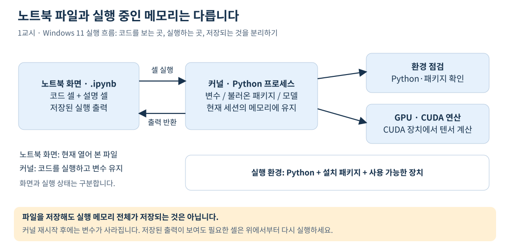

# Transformer 이후 현대 LLM/VLM 아키텍처 변화의 이해와 실습

## 이 교시의 학습 순서

각 실습은 **개념 → 관련 그림 → 코드 설명 → 코드 실행 → 출력 설명** 순서로 진행합니다. 그림은 실행 전에 경로와 축을 파악하는 자료입니다. 코드와 실제 출력은 함께 제공된 Notebook에서 확인하고, 각 코드 바로 뒤의 **출력 설명**에서 결과와 검증 범위를 연결합니다. 저장된 출력이 없는 셀은 정적 코드 설명과 구분하며 실행 성공으로 취급하지 않습니다.

### 이번 교시 핵심 용어

런타임(runtime) · 커널(kernel) · 가상환경(virtual environment) · CUDA 연산(CUDA computation)


**공통 실행 환경:** 1~14교시 모두 제1교시에서 준비한 NVIDIA RTX GPU 탑재 Windows 11 PC와 같은 프로젝트 환경을 사용합니다. CPU 전용 환경으로 전환하지 않고 같은 Windows GPU 환경을 유지합니다. 설정 읽기·소스 분석·일반 산술·토론은 GPU PC에서 진행하되 CUDA 연산이나 대형 모델 가중치 로드가 필요하지 않습니다. 실제 가중치·텐서 실습은 해당 셀의 CUDA 검사를 통과해야 합니다.


## 제1교시 — 오리엔테이션 및 Windows GPU 실습 환경 준비

Windows 11 x64 · NVIDIA RTX GPU 0 전용 VRAM 8 GB 이상 · 공식 Python 3.12.10 · PyTorch 2.9.1+cu126 · Pillow 이미지 처리

**검증 범위:** VRAM 8GB 이상은 실습 준비 기준이지 8GB 실물 GPU에서의 검증 완료를 뜻하지 않습니다. 저장된 실제 실행 결과의 GPU 이름은 검증 장비 기록이며 구매·준비할 필수 모델명이 아닙니다. 메모리 사용은 입력과 다른 프로그램의 점유에 따라 달라집니다.

준비 파일: `lesson01-windows-gpu-starter.zip`.

## 오리엔테이션 — 이틀 동안 무엇을 배우나요?

대규모 언어 모델(LLM)과 비전-언어 모델(VLM)이 **무엇을 바꾸었고, 왜 바꾸었는지**를 실제 설정과 레이어로 확인합니다. 텍스트 생성에서 이미지 입력까지 흐름을 따라가며, 메모리·연산 조건을 근거로 모델을 비교합니다.

### 과정 목표

- Transformer 이후 구조가 어떻게 바뀌었는지, 그 변화가 필요한 이유를 설명합니다.
- 실제 모델의 config와 레이어를 읽고 텍스트·이미지 정보가 흐르는 경로를 짚습니다.
- 주어진 조건에서 메모리·연산 특성을 비교하고 모델 선택의 근거를 제시합니다.

실습은 **Windows 11의 로컬 GPU와 VS Code Notebook**을 중심으로 진행합니다. 서버 구축·모델 서빙은 필수가 아니며 AI 코딩 에이전트는 선택 도구입니다. 뒤 차시의 모델명은 구조를 관찰할 대표 사례이며, 모든 대형 모델을 강의장 GPU에 올려 실행한다는 뜻은 아닙니다.

### 교시별 핵심 논문·기술 보고서

교시별로 다루는 구조를 확인할 때 아래 원문을 참고합니다. **설계와 그 이유**는 논문·기술 보고서에서, **특정 공개 모델의 실제 설정값**은 해당 버전의 설정 파일과 구현 코드에서 확인합니다. 공개 자료에서 확인할 수 없는 내부 구조나 학습 세부 사항은 추정으로 채우지 않습니다.

| 교시 | 읽을 자료 | 원문에서 확인할 내용 |
|---|---|---|
| 2–3 | [Attention Is All You Need](https://arxiv.org/abs/1706.03762) · [Improving Language Understanding by Generative Pre-Training](https://cdn.openai.com/research-covers/language-unsupervised/language_understanding_paper.pdf) | 원래 Transformer의 인코더·디코더와 GPT의 디코더 기반 언어 모델을 구분하고, 토큰 임베딩에서 다음 토큰 확률까지의 흐름을 확인합니다. |
| 4 | [RMSNorm](https://arxiv.org/abs/1910.07467) · [GLU Variants Improve Transformer](https://arxiv.org/abs/2002.05202) · [RoFormer](https://arxiv.org/abs/2104.09864) | RMSNorm의 정규화 방식, 게이트를 쓰는 FFN의 예인 SwiGLU, 어텐션에 위치 정보를 넣는 RoPE를 각 원문에서 확인합니다. |
| 5 | [GQA: Training Generalized Multi-Query Transformer Models](https://aclanthology.org/2023.emnlp-main.298/) | 여러 쿼리 헤드가 키·값 헤드를 공유하는 방식과 KV 캐시 크기가 달라지는 이유를 확인합니다. |
| 6 | [Mistral 7B](https://arxiv.org/abs/2310.06825) · [K-EXAONE Technical Report](https://arxiv.org/abs/2601.01739) | Mistral 논문에서는 슬라이딩 윈도우의 원리를, K-EXAONE 보고서에서는 로컬·전체 어텐션의 층 배치 사례를 읽습니다. |
| 7 | [Switch Transformers](https://arxiv.org/abs/2101.03961) | 토큰을 일부 전문가에게 보내는 라우팅을 살펴보고, 전체 파라미터와 토큰당 활성 파라미터를 구분합니다. |
| 8 | GPT-2 [보고서](https://cdn.openai.com/better-language-models/language_models_are_unsupervised_multitask_learners.pdf)·[설정](https://huggingface.co/openai-community/gpt2/blob/607a30d783dfa663caf39e06633721c8d4cfcd7e/config.json), Qwen3-4B [보고서](https://arxiv.org/abs/2505.09388)·[설정](https://huggingface.co/Qwen/Qwen3-4B/blob/1cfa9a7208912126459214e8b04321603b3df60c/config.json), DeepSeek-V3 [보고서](https://arxiv.org/abs/2412.19437)·[설정](https://huggingface.co/deepseek-ai/DeepSeek-V3/blob/e815299b0bcbac849fa540c768ef21845365c9eb/config.json), K-EXAONE 236B-A23B [보고서](https://arxiv.org/abs/2601.01739)·[설정](https://huggingface.co/LGAI-EXAONE/K-EXAONE-236B-A23B/blob/61e6d578eb102b578e5704e2916ac841df9eca0a/config.json) | GPT-2를 기본 디코더 사례로 삼아 Qwen3-4B의 GQA·Dense FFN, DeepSeek-V3의 MLA·MoE, K-EXAONE의 로컬·전체 어텐션 층 배치와 MoE를 비교합니다. 보고서의 설계 설명을 해당 체크포인트의 설정에서 확인합니다. |
| 9 | [Sarathi-Serve](https://arxiv.org/abs/2403.02310) | 프롬프트를 먼저 처리하는 Prefill과 새 토큰을 순차적으로 만드는 Decode의 계산 특성이 왜 다른지 확인합니다. 논문에 나온 지연시간을 강의실 PC의 측정값으로 쓰지 않습니다. |
| 10 | [DeepSeek-R1 기술 보고서](https://arxiv.org/abs/2501.12948) | 추론 후학습과 출력 평가의 사례를 봅니다. 보고서의 학습 방법과 수업에서 관찰하는 출력은 구분합니다. |
| 11 | [An Image is Worth 16x16 Words (ViT)](https://arxiv.org/abs/2010.11929) | 이미지를 패치로 나누고 선형 투영과 위치 임베딩을 거쳐 Transformer에 입력하는 방법을 확인합니다. |
| 12 | [Visual Instruction Tuning (LLaVA)](https://arxiv.org/abs/2304.08485) | 비전 인코더의 출력을 언어 모델이 받는 형태로 바꾸는 프로젝터를 공개된 구조도와 본문에서 확인합니다. |

13교시에는 추천 근거에 사용한 모델 버전과 출처를 함께 적고, 논문에 보고된 결과와 직접 실행해 관찰한 결과를 구분합니다.

**이번 교시의 도착점:** 본인 계정의 VS Code에서 올바른 `.venv` 커널을 선택하고, 실제 GPU 이름과 CUDA 텐서 계산 결과를 확인·저장하는 것입니다. 아래 설치 단계는 이 목표를 위한 준비입니다.

## 시작 전 확인: 실행 계정과 설치 권한
- 본인 Windows 계정의 **일반 권한 PowerShell 7**에서 진행합니다. 각 `& { ... }` 블록 전체를 한 번씩 실행하고 결과를 확인한 뒤 다음으로 넘어갑니다. 모두 한꺼번에 실행하지 않습니다.
- 기존 프로젝트·Python·`.venv`는 덮어쓰거나 삭제하지 않습니다. 오류가 나면 그 단계에서 멈추고 명령·오류·실행 경로를 보존합니다.
- 관리자 권한/UAC, 드라이버 변경, 재부팅은 PC 소유자 또는 기관 담당자의 사전 승인이 필요합니다. PATH·보안 정책·파일 차단 설정을 임의로 바꾸지 않습니다.
- **보안 범위:** Python 3.12.10은 공식 3.12 Windows 설치판이지만 이후 보안 수정이 포함되지 않습니다. 최신 보안판으로 간주하지 말고 담당자가 승인한 환경에서만 사용합니다.
- 블록은 경로를 자체 설정합니다. `Lesson01` 접두사 변수는 같은 창에서 검증 결과를 이어 줍니다. 새 창에서는 해당 확인 블록부터 다시 실행합니다.

## 1. PowerShell 7 열기 및 Windows 11 환경 확인
시작 메뉴에서 **PowerShell 7**을 일반 권한으로 직접 엽니다. Windows PowerShell 5.1이나 다른 도구의 내장 셸로 대신하지 않습니다. 없으면 [Microsoft 공식 설치 안내](https://learn.microsoft.com/powershell/scripting/install/installing-powershell-on-windows)의 승인된 사용자 설치 경로를 이용합니다.
레지스트리에 Windows 10 Pro라는 이름이 남아도 실제 Windows 11일 수 있습니다. 아래는 제품명 대신 빌드·아키텍처로 확인합니다.

```powershell
& {
    $ErrorActionPreference = 'Stop'
    $PSNativeCommandUseErrorActionPreference = $false
    $PSVersionTable.PSVersion
    if ($PSVersionTable.PSVersion.Major -lt 7) { throw 'PowerShell 7 창에서 다시 시작하세요.' }
    $os = Get-ItemProperty 'HKLM:\SOFTWARE\Microsoft\Windows NT\CurrentVersion'
    $architecture = [System.Runtime.InteropServices.RuntimeInformation]::OSArchitecture
    if ($architecture -ne [System.Runtime.InteropServices.Architecture]::X64 -or -not [Environment]::Is64BitOperatingSystem -or $os.InstallationType -ne 'Client' -or [int]$os.CurrentBuildNumber -lt 22000) { throw 'Windows 11 64비트 클라이언트 환경을 확인하세요.' }
    $build = [string]$os.CurrentBuildNumber
    if ($null -ne $os.UBR) { $build += ".$($os.UBR)" }
    Write-Host "[PASS] Windows 11 x64 클라이언트 / 빌드 $build / PowerShell $($PSVersionTable.PSVersion)"
    Write-Host "현재 계정: $env:USERNAME"
    Write-Host "사용자 경로: $env:USERPROFILE"
}
```

**정상:** `[PASS] Windows 11 x64 클라이언트`, 빌드(예: 26300.9974), 본인 계정·경로가 표시됩니다. PASS가 없거나 계정이 다르면 먼저 확인합니다.

## 2. NVIDIA GPU 인식·전용 메모리 확인
먼저 조회 도구를 찾습니다. 이 단계는 드라이버나 설정을 변경하지 않습니다.

```powershell
& {
    $ErrorActionPreference = 'Stop'
    $PSNativeCommandUseErrorActionPreference = $false
    Get-Command nvidia-smi -ErrorAction SilentlyContinue
}
```

명령이 발견되었을 때만 아래 조회를 실행합니다.

```powershell
& {
    $ErrorActionPreference = 'Stop'
    $PSNativeCommandUseErrorActionPreference = $false
    nvidia-smi
    if ($LASTEXITCODE -ne 0) { throw 'NVIDIA 상태 확인 실패. GPU 설치를 진행하지 마세요.' }
    nvidia-smi --query-gpu=index,name,driver_version,memory.total --format=csv
    if ($LASTEXITCODE -ne 0) { throw 'GPU 메모리 확인 실패.' }
}
```

첫 검색에서 아무것도 나오지 않았을 때만 아래 기본 위치 조회를 사용합니다. 앞의 조회가 성공했다면 건너뜁니다.

```powershell
& {
    $ErrorActionPreference = 'Stop'
    $PSNativeCommandUseErrorActionPreference = $false
    $paths = @(
        (Join-Path $env:windir 'System32\nvidia-smi.exe'),
        (Join-Path $env:ProgramFiles 'NVIDIA Corporation\NVSMI\nvidia-smi.exe')
    )
    $smi = $paths | Where-Object { Test-Path -LiteralPath $_ -PathType Leaf } | Select-Object -First 1
    if (-not $smi) { throw 'NVIDIA 조회 도구가 기본 위치에 없습니다. GPU 경로를 중단하고 담당자에게 확인하세요.' }
    Write-Host "NVIDIA 조회 경로: $smi"
    & $smi --query-gpu=index,name,driver_version,memory.total --format=csv
    if ($LASTEXITCODE -ne 0) { throw 'NVIDIA 직접 조회 실패. 설정을 변경하지 말고 담당자에게 오류를 전달하세요.' }
}
```

**정상:** GPU 0의 이름·드라이버·메모리가 표시됩니다. **제품 사양상 전용 VRAM 8 GB 이상**이어야 합니다. 검증기의 7500 MiB 기준은 8 GB급 카드의 실표시 용량을 다루기 위한 기준이지 최소 사양을 낮춘 뜻이 아닙니다. 다른 GPU의 메모리로 대신 판단하지 않습니다. GPU가 없거나 부족하거나 조회가 실패하면 중단합니다.
`nvidia-smi`의 CUDA Version은 드라이버 지원 범위입니다. 실제 CUDA 연산은 9절에서 확인합니다. 정상 드라이버는 그대로 사용하며, 정상 Game Ready 드라이버를 Studio로 바꿀 필요도 없습니다.

### 필요한 경우: NVIDIA 드라이버 설치·업데이트

1. 장치 관리자 → 디스플레이 어댑터 또는 제조사 사양표에서 정확한 GPU와 데스크톱/노트북 여부를 확인합니다.
2. [NVIDIA 공식 드라이버 페이지](https://www.nvidia.com/ko-kr/drivers/)에서 모델을 선택합니다. **데스크톱 GeForce RTX 제품:** GeForce → 본인 GPU의 RTX 시리즈 → 정확한 GPU 모델 → Windows 11. 실습 준비 기준은 NVIDIA RTX GPU의 전용 VRAM 8GB 이상이며, 특정 RTX 모델을 필수로 지정하지 않습니다. 언어와 Studio 선택이 제공되면 선택합니다. 결과가 Studio/Game Ready로 함께 나올 수도 있습니다.
3. 상세 페이지의 **Supported Products / 지원 제품**과 운영체제가 정확히 맞는지 확인하고 공식 Windows `.exe`를 받습니다. [데스크톱 예시](https://www.nvidia.com/en-us/drivers/details/285317/)는 화면 참고용이지 특정 버전 설치 지시가 아닙니다.
4. 설치·UAC·재부팅 승인을 먼저 받습니다. 제공된다면 그래픽 드라이버만 설치할 수 있으며 NVIDIA App은 필수가 아닙니다. 방식이 표시되면 승인된 **빠른 설치(Express/권장)**를 따릅니다. 기본적으로 Clean installation/초기화나 타사 제거 도구를 사용하지 않습니다.
5. 승인된 설치·필요한 재부팅 후 위 조회를 다시 합니다. 계속 실패하면 반복 설치하지 말고 담당자에게 전달합니다.
**노트북:** Notebook 시리즈와 정확한 Laptop GPU를 선택합니다. [노트북 예시](https://www.nvidia.com/en-us/geforce/drivers/details/285318/)의 지원 목록도 확인하고 제조사 인증 드라이버·기관 지침을 우선합니다. **워크스테이션:** RTX A4500 등에 GeForce를 선택하지 말고 해당 제품군의 제조사 승인 Enterprise/드라이버 계열을 확인합니다.

## 3. 본인 계정에 VS Code와 Python·Jupyter 확장 준비
아래는 현재 계정의 기본 설치 경로만 확인합니다. 없으면 [공식 Windows 안내](https://code.visualstudio.com/docs/setup/windows)의 **Windows x64 User Installer**로 본인 계정에 먼저 설치한 뒤 다시 확인합니다. 관리자 요청은 임의로 승인하지 않습니다.

```powershell
& {
    $ErrorActionPreference = 'Stop'
    $PSNativeCommandUseErrorActionPreference = $false
    $code = Join-Path $env:LOCALAPPDATA 'Programs\Microsoft VS Code\bin\code.cmd'
    if (-not (Test-Path -LiteralPath $code -PathType Leaf)) { throw '현재 계정의 기본 위치에 VS Code가 없습니다. Windows x64 User Installer로 이 계정에 설치한 뒤 이 블록을 다시 실행하세요. 사용자 지정 설치는 아래 GUI 안내를 따르세요.' }
    Write-Host "현재 계정 VS Code: $code"
    & $code --version
    if ($LASTEXITCODE -ne 0) { throw '현재 계정 VS Code 실행 실패. 오류와 위 경로를 확인하고 중단하세요.' }
    Write-Host '[PASS] 현재 계정 VS Code 버전 확인'
}
```

**정상:** 버전과 `[PASS] 현재 계정 VS Code 버전 확인`입니다. 다른 계정의 AppData나 EPERM 오류가 나오면 중단합니다. PATH·권한을 바꾸거나 다른 앱을 강제 종료하지 않습니다.

### Python·Jupyter 확장 설치 및 확인

본인 사용자 지정 위치에 설치했다면 그 VS Code GUI를 사용합니다. 첫 시작 안내는 닫아도 됩니다. **Ctrl+Shift+X** → `@id:ms-python.python` 검색 → Microsoft **Python** → Install. 이어서 `@id:ms-toolsai.jupyter` → Microsoft **Jupyter**를 설치합니다. **Installed이면 건너뜁니다.**
아래는 설치가 아닌 결과 목록 확인입니다. 사용자 지정 설치는 GUI의 Installed 상태로 확인합니다.

```powershell
& {
    $ErrorActionPreference = 'Stop'
    $PSNativeCommandUseErrorActionPreference = $false
    $code = Join-Path $env:LOCALAPPDATA 'Programs\Microsoft VS Code\bin\code.cmd'
    if (-not (Test-Path -LiteralPath $code -PathType Leaf)) { throw '현재 계정 VS Code 기본 경로가 없습니다. 3절에서 먼저 설치·확인하거나 본인 사용자 지정 설치의 GUI를 사용하세요.' }
    & $code --list-extensions --show-versions
    if ($LASTEXITCODE -ne 0) { throw '확장 목록 확인 실패.' }
}
```

**정상:** 두 확장 ID가 목록에 있거나 GUI에서 Installed입니다. 과거 CLI 설치의 DEP0169 경고만으로 실패를 판단하지 않지만, EPERM·비정상 종료 등 실제 오류는 무시하지 않습니다.

## 4. 스타터 ZIP 풀기 및 필수 실습 파일 확인

**클린 설치:** 기존 과정 Notebook의 커널과 VS Code 작업 영역을 먼저 닫으세요. 기존 폴더 이름을 수동으로 바꿀 필요는 없습니다. 아래 명령은 새 ZIP을 임시 폴더에 먼저 풀고 필수 파일과 새 검증기를 확인합니다. 그다음 기존 프로젝트가 있으면 `modern-llm-vlm-architecture-backup`으로 보관하고, 같은 백업 이름이 이미 있으면 날짜와 짧은 식별자를 붙입니다. 새 프로젝트는 원래 이름에 배치합니다. 이전 폴더나 `.venv`를 삭제하거나 새 프로젝트에 복사하지 않습니다.

최신 `Windows11_Course_Executed.zip` 안의 `lesson01-windows-gpu-starter.zip`을 본인 Downloads에 놓습니다. 파일명에 `(1)` 등이 붙었다면 아래 `$zip`의 이름만 실제 이름으로 바꾸세요. 최신 ZIP의 검사가 실패하면 기존 폴더는 이동하지 않습니다.

```powershell
& {
    $ErrorActionPreference = 'Stop'
    $parent = Join-Path $env:USERPROFILE 'AI-Engineering'
    $name = 'modern-llm-vlm-architecture'
    $root = Join-Path $parent $name
    $zip = Join-Path $HOME 'Downloads\lesson01-windows-gpu-starter.zip'
    if (-not (Test-Path -LiteralPath $zip -PathType Leaf)) { throw '최신 Starter ZIP 위치를 확인하세요.' }
    New-Item -ItemType Directory -Path $parent -Force | Out-Null
    $stage = Join-Path $parent ('.lesson01-stage-' + [guid]::NewGuid().ToString('N'))
    $required = @('requirements-core.txt','scripts\verify_env.py','lessons\lesson01\lesson01.ipynb','modern-llm-vlm-architecture.code-workspace')
    $backup = $null
    $moved = $false
    Set-Location -LiteralPath $parent
    try {
        Expand-Archive -LiteralPath $zip -DestinationPath $stage
        foreach ($item in $required) {
            if (-not (Test-Path -LiteralPath (Join-Path $stage $item) -PathType Leaf)) { throw "새 ZIP에 필수 파일 없음: $item" }
        }
        if (-not (Select-String -LiteralPath (Join-Path $stage 'scripts\verify_env.py') -SimpleMatch -Pattern 'cuda-pillow' -Quiet)) {
            throw '이전 Starter ZIP입니다. 새로 첨부된 ZIP 안의 스타터 파일을 사용하세요.'
        }
        if (Test-Path -LiteralPath $root) {
            $old = Get-Item -LiteralPath $root -Force
            if (-not $old.PSIsContainer -or ($old.Attributes -band [IO.FileAttributes]::ReparsePoint)) {
                throw '기존 경로가 일반 폴더가 아닙니다. 건드리지 않고 중단합니다.'
            }
            $backup = Join-Path $parent ($name + '-backup')
            if (Test-Path -LiteralPath $backup) {
                $backup = Join-Path $parent ($name + '-backup-' + (Get-Date -Format 'yyyyMMdd-HHmmss-fff') + '-' + [guid]::NewGuid().ToString('N').Substring(0,8))
            }
            [IO.Directory]::Move($root, $backup)
            $moved = $true
        }
        [IO.Directory]::Move($stage, $root)
    } catch {
        $cause = $_
        if ($moved) {
            if (-not (Test-Path -LiteralPath $root)) {
                try {
                    [IO.Directory]::Move($backup, $root)
                    Write-Host "기존 프로젝트 복원: $root"
                } catch {
                    Write-Warning "자동 복원 실패. 기존 프로젝트는 백업에 있습니다: $backup"
                }
            } else {
                Write-Warning "기본 경로가 다시 생겼습니다. 기존 프로젝트는 백업에 있습니다: $backup"
            }
        }
        if (Test-Path -LiteralPath $stage) { Write-Warning "확인용 임시 폴더: $stage" }
        throw $cause
    }
    if ($moved) { Write-Host "[PASS] 기존 프로젝트 백업: $backup" }
    Write-Host "[PASS] 새 Starter 배치: $root"
    Get-ChildItem -LiteralPath $root -Force
}
```

```powershell
& {
    $ErrorActionPreference = 'Stop'
    $PSNativeCommandUseErrorActionPreference = $false
    $root = Join-Path $env:USERPROFILE 'AI-Engineering\modern-llm-vlm-architecture'
    if (-not (Test-Path -LiteralPath $root -PathType Container)) { throw '4절 Starter 압축 해제를 먼저 완료하세요.' }
    $required = @('requirements-core.txt','scripts\verify_env.py','lessons\lesson01\lesson01.ipynb','modern-llm-vlm-architecture.code-workspace')
    foreach ($item in $required) {
        if (-not (Test-Path -LiteralPath (Join-Path $root $item) -PathType Leaf)) { throw "필수 파일 없음: $item" }
    }
    Set-Location -LiteralPath $root
}
```

**정상:** 새 Starter 배치가 PASS이고 requirements, verifier, Notebook, workspace 네 파일이 확인됩니다. 기존 폴더가 있었다면 백업 경로도 출력됩니다. 이어서 5절부터 진행하고 7절에서 새 `.venv`를 만드세요. 작업이 실패한 경우 다시 실행하기 전에 오류와 출력된 백업 경로를 확인합니다.

## 5. uv 확인 및 필요한 경우 설치
uv는 이후 가상환경·패키지 관리에 사용합니다. 먼저 현재 상태를 읽습니다.

```powershell
& {
    $ErrorActionPreference = 'Stop'
    $PSNativeCommandUseErrorActionPreference = $false
    Get-Command uv -ErrorAction SilentlyContinue
}
```

### uv가 없을 때만 설치

정상인 현재 계정 uv가 있으면 아래 블록은 `[SKIP]`하고 설치·업데이트하지 않습니다. 없을 때만 공식 WinGet 사용자 설치를 합니다. 출처·조건을 확인하며 다른 계정 경로나 실행 오류가 나오면 멈춥니다.

```powershell
& {
    $ErrorActionPreference = 'Stop'
    $PSNativeCommandUseErrorActionPreference = $false
    $uvCommand = Get-Command uv.exe -CommandType Application -ErrorAction SilentlyContinue
    $ownRoot = [IO.Path]::GetFullPath($env:USERPROFILE).TrimEnd('\') + '\'
    $uvPath = $null
    if ($uvCommand) {
        $uvPath = [IO.Path]::GetFullPath($uvCommand.Source)
        if (-not $uvPath.StartsWith($ownRoot, [StringComparison]::OrdinalIgnoreCase)) {
            throw "uv 경로가 현재 사용자 폴더 밖입니다: $uvPath. 실행하지 않았습니다. 다른 계정 경로인지 담당자에게 확인하세요."
        }
    } else {
        $known = @((Join-Path $env:LOCALAPPDATA 'Microsoft\WinGet\Links\uv.exe'), (Join-Path $HOME '.local\bin\uv.exe'))
        $uvPath = $known | Where-Object { Test-Path -LiteralPath $_ -PathType Leaf } | Select-Object -First 1
    }
    if ($uvPath) {
        $uvItem = Get-Item -LiteralPath $uvPath
        $resolved = $uvItem.ResolveLinkTarget($true)
        if ($resolved -and -not $resolved.FullName.StartsWith($ownRoot, [StringComparison]::OrdinalIgnoreCase)) {
            throw "uv 링크 대상이 현재 사용자 폴더 밖입니다: $($resolved.FullName). 실행하지 않았습니다. 담당자에게 확인하세요."
        }
    }
    if ($uvPath) {
        & $uvPath --version
        if ($LASTEXITCODE -ne 0) { throw '현재 계정 uv 실행 실패. 설치나 업데이트를 반복하지 말고 오류를 확인하세요.' }
        Write-Host "[SKIP] 현재 계정 uv가 정상입니다. 설치/업데이트하지 않습니다: $uvPath"
        return
    }
    winget install --id astral-sh.uv --exact --source winget --scope user
    if ($LASTEXITCODE -ne 0) { throw 'uv 설치가 완료되지 않았습니다. 관리자 설치로 전환하지 마세요.' }
}
```

### 새 PowerShell에서 uv 실행 확인

설치 후 PowerShell 7을 새로 열어 아래를 확인합니다. 실행 파일이 있어도 현재 창의 명령이 같은 파일을 가리키지 않으면 중단합니다. PATH를 임의로 편집하지 않습니다.

```powershell
& {
    $ErrorActionPreference = 'Stop'
    $PSNativeCommandUseErrorActionPreference = $false
    $uvCommand = Get-Command uv.exe -CommandType Application -ErrorAction SilentlyContinue
    $ownRoot = [IO.Path]::GetFullPath($env:USERPROFILE).TrimEnd('\') + '\'
    $uvPath = $null
    if ($uvCommand) {
        $uvPath = [IO.Path]::GetFullPath($uvCommand.Source)
        if (-not $uvPath.StartsWith($ownRoot, [StringComparison]::OrdinalIgnoreCase)) {
            throw "uv 경로가 현재 사용자 폴더 밖입니다: $uvPath. 실행하지 않았습니다. 다른 계정 경로인지 담당자에게 확인하세요."
        }
    } else {
        $known = @((Join-Path $env:LOCALAPPDATA 'Microsoft\WinGet\Links\uv.exe'), (Join-Path $HOME '.local\bin\uv.exe'))
        $uvPath = $known | Where-Object { Test-Path -LiteralPath $_ -PathType Leaf } | Select-Object -First 1
    }
    if ($uvPath) {
        $uvItem = Get-Item -LiteralPath $uvPath
        $resolved = $uvItem.ResolveLinkTarget($true)
        if ($resolved -and -not $resolved.FullName.StartsWith($ownRoot, [StringComparison]::OrdinalIgnoreCase)) {
            throw "uv 링크 대상이 현재 사용자 폴더 밖입니다: $($resolved.FullName). 실행하지 않았습니다. 담당자에게 확인하세요."
        }
    }
    if (-not $uvPath) { throw '현재 계정 uv를 찾지 못했습니다. 설치 결과를 확인하고 새 PowerShell 7 창에서 다시 확인하세요.' }
    & $uvPath --version
    if ($LASTEXITCODE -ne 0) { throw '현재 계정 uv 실행 실패. 다음 단계로 진행하지 마세요.' }
    $shellUv = Get-Command uv -ErrorAction SilentlyContinue
    if (-not $uvCommand -or -not $shellUv -or $shellUv.CommandType -ne 'Application' -or
        -not ([IO.Path]::GetFullPath($shellUv.Source)).Equals($uvPath, [StringComparison]::OrdinalIgnoreCase)) {
        throw 'uv 설치 파일은 있지만 이 창의 uv 명령이 같은 현재 계정 파일로 연결되지 않습니다. PowerShell 7을 새로 열고 이 확인 블록을 다시 실행하세요. 계속 실패하면 담당자에게 문의하고 PATH를 임의로 바꾸지 마세요.'
    }
    Write-Host "[PASS] 현재 계정 uv 및 이 창의 명령 경로 확인: $uvPath"
}
```

**정상:** uv 버전과 현재 계정 명령 경로 PASS입니다. WinGet이 없거나 사용자 설치가 불가능하면 [uv 공식 설치 안내](https://docs.astral.sh/uv/getting-started/installation/)를 담당자와 확인합니다. 다운로드 스크립트를 정책 우회로 실행하지 않습니다.

## 6. 공식 Python 3.12.10 설치 및 실행 확인

### 설치 파일 다운로드 및 서명 확인

[Python 3.12.10 공식 릴리스](https://www.python.org/downloads/release/python-31210/)의 **Files 표 → Windows installer (64-bit)**를 받습니다. 상단 install manager, ARM64, 32-bit, embeddable, 소스 파일이 아닙니다. `python-3.12.10-amd64.exe`를 Downloads에 저장하고 실행 전 서명부터 확인합니다. 파일명이 바뀌었다면 실제 이름으로 맞춥니다.

```powershell
& {
    $ErrorActionPreference = 'Stop'
    $PSNativeCommandUseErrorActionPreference = $false
    $installer = Join-Path $HOME 'Downloads\python-3.12.10-amd64.exe'
    if (-not (Test-Path -LiteralPath $installer -PathType Leaf)) { throw '공식 설치 파일의 실제 다운로드 위치를 확인하세요.' }
    $signature = Get-AuthenticodeSignature -LiteralPath $installer
    $publisher = if ($signature.SignerCertificate) { $signature.SignerCertificate.GetNameInfo([System.Security.Cryptography.X509Certificates.X509NameType]::SimpleName, $false) } else { '' }
    Write-Host "서명 상태: $($signature.Status) / 게시자: $publisher"
    Get-FileHash -LiteralPath $installer -Algorithm SHA256
    if ($signature.Status -ne 'Valid' -or $publisher -ne 'Python Software Foundation') { throw '유효한 Python Software Foundation 서명이 확인되지 않았습니다. 설치 파일을 실행하지 마세요.' }
    Write-Host '[PASS] 공식 설치 파일 서명 확인. 설치는 아래 화면 안내를 따르세요.'
}
```

**정상:** Authenticode `Valid`, 게시자 `Python Software Foundation`. 서명 오류이면 설치하지 않습니다. 유효 서명은 기관의 사용 승인을 대신하지 않습니다.

### 서명 확인 후 본인 계정에 설치

1. 승인된 파일을 열고 **Customize installation**에서 옵션을 확인합니다. 기본 위치는 `%LOCALAPPDATA%\Programs\Python\Python312`입니다.
2. **Add python.exe to PATH**, **Use admin privileges when installing py.exe**를 선택하지 않습니다. 선택 기능의 **py launcher / Python Launcher**, **for all users**도 해제합니다.
3. Advanced Options의 **Install for all users**, **Add Python to environment variables**를 해제합니다. 기본 위치 또는 담당자가 승인한 현재 사용자 안의 별도 위치만 사용합니다. Modify/Repair나 기존 설치가 보이면 덮어쓰지 말고 확인합니다.
4. UAC가 뜨면 멈춥니다. **Setup was successful → Close**로 닫습니다. **Disable path length limit**는 누르지 않습니다.

### 설치한 Python의 서명과 실행 확인

아래 기본값은 본인 계정의 설치 경로입니다. 승인된 사용자 지정 설치만 정확한 전체 경로로 바꿉니다. uv 관리 Python이나 다른 계정의 파일을 고르지 않습니다.

```powershell
& {
    $ErrorActionPreference = 'Stop'
    $PSNativeCommandUseErrorActionPreference = $false
    $global:Lesson01DetectedPython = $null
    $global:Lesson01BasePython = $null
    $global:Lesson01ValidatedBasePython = $null
    $basePython = Join-Path $env:LOCALAPPDATA 'Programs\Python\Python312\python.exe'
    $ownRoot = [IO.Path]::GetFullPath($env:USERPROFILE).TrimEnd('\') + '\'
    if (-not [IO.Path]::IsPathFullyQualified($basePython) -or -not (Test-Path -LiteralPath $basePython -PathType Leaf)) { throw '공식 Python 설치 위치의 python.exe를 확인하세요.' }
    $basePython = [IO.Path]::GetFullPath($basePython)
    if (-not $basePython.StartsWith($ownRoot, [StringComparison]::OrdinalIgnoreCase) -or $basePython -match '[\\/]uv[\\/]python[\\/]') { throw '현재 계정에 설치한 공식 Python 경로만 사용합니다. uv 관리 또는 다른 계정 경로를 선택하지 마세요.' }
    $signature = Get-AuthenticodeSignature -LiteralPath $basePython
    $publisher = if ($signature.SignerCertificate) { $signature.SignerCertificate.GetNameInfo([System.Security.Cryptography.X509Certificates.X509NameType]::SimpleName, $false) } else { '' }
    Write-Host "실행 파일: $basePython"
    Write-Host "서명 상태: $($signature.Status) / 게시자: $publisher"
    if ($signature.Status -ne 'Valid' -or $publisher -ne 'Python Software Foundation') { throw '설치된 python.exe의 유효한 PSF 서명이 확인되지 않았습니다. 실행하지 마세요.' }
    $global:Lesson01DetectedPython = $basePython
}
```

```powershell
& {
    $ErrorActionPreference = 'Stop'
    $PSNativeCommandUseErrorActionPreference = $false
    $global:Lesson01BasePython = $null
    $global:Lesson01ValidatedBasePython = $null
    $basePython = $global:Lesson01DetectedPython
    if (-not $basePython) { throw '바로 앞의 공식 Python 실행 파일 서명 확인을 이 창에서 먼저 완료하세요.' }
    & $basePython --version
    if ($LASTEXITCODE -ne 0) { throw '공식 Python 직접 실행 실패. 가상환경을 만들지 마세요.' }
    $global:Lesson01BasePython = $basePython
}
```

```powershell
& {
    $ErrorActionPreference = 'Stop'
    $PSNativeCommandUseErrorActionPreference = $false
    $basePython = $global:Lesson01BasePython
    $global:Lesson01ValidatedBasePython = $null
    if (-not $basePython) { throw '공식 Python 서명 확인과 --version 블록을 이 창에서 먼저 실행하세요.' }
    & $basePython -I -B -c "import sys,struct; print(sys.executable); print(sys.version); print('bits:',struct.calcsize('P')*8); assert sys.version_info[:3]==(3,12,10); assert struct.calcsize('P')==8; assert sys.prefix==sys.base_prefix; import _overlapped,asyncio; print('[PASS] Official base Python 3.12.10 x64 native imports')"
    if ($LASTEXITCODE -ne 0) { throw '공식 Python 버전·64비트·네이티브 import 검사 실패. 여기서 중단하고 오류를 보존하세요.' }
    $global:Lesson01ValidatedBasePython = $basePython
}
```

**정상:** 공식 파일의 PSF 서명, Python 3.12.10, bits 64, 기본 네이티브 import PASS입니다. uv Python 설치 명령을 추가로 실행하지 않습니다. 기본 실행 성공과 `.venv`의 실행 성공은 별도입니다.

## 7. 프로젝트 가상환경 만들기 및 Python 실행 확인
6절의 서명·직접 실행 검사를 통과한 같은 창에서 진행합니다. 새 창이면 실행 파일 서명 확인과 두 직접 실행 블록부터 다시 합니다. Python을 다시 설치할 필요는 없습니다.
**기존 `.venv`는 재생성하지 않습니다.** Python 버전이 같아도 가상환경을 만든 Python의 설치 출처가 다를 수 있습니다. 공식 서명 Python 경로와 생성 출처가 맞지 않거나 불명확하면 기존 환경을 보존하고 담당자에게 확인합니다. 기존 가상환경을 새 Python으로 바꿔 쓰지 않습니다.

```powershell
& {
    $ErrorActionPreference = 'Stop'
    $PSNativeCommandUseErrorActionPreference = $false
    $basePython = $global:Lesson01ValidatedBasePython
    if (-not $basePython -or $basePython -ne $global:Lesson01BasePython) { throw '6절의 실행 파일 확인 및 두 직접 실행 검사를 이 창에서 먼저 완료하세요.' }
    $root = Join-Path $env:USERPROFILE 'AI-Engineering\modern-llm-vlm-architecture'
    $venv = Join-Path $root '.venv'
    if (Test-Path -LiteralPath $venv) { throw '기존 .venv가 있습니다. 삭제하거나 덮어쓰지 말고 상태를 확인하세요.' }
    uv venv $venv --python $basePython --no-python-downloads
    if ($LASTEXITCODE -ne 0) { throw '가상환경 생성 실패. 부분 생성 폴더를 보존하고 중단하세요.' }
}
```

```powershell
& {
    $ErrorActionPreference = 'Stop'
    $PSNativeCommandUseErrorActionPreference = $false
    $root = Join-Path $env:USERPROFILE 'AI-Engineering\modern-llm-vlm-architecture'
    $venv = Join-Path $root '.venv'
    $py = Join-Path $venv 'Scripts\python.exe'
    if (-not (Test-Path -LiteralPath $py -PathType Leaf)) { throw '프로젝트 .venv가 없습니다. 7절 완료 여부를 확인하세요.' }
    & $py --version
    if ($LASTEXITCODE -ne 0) { throw '가상환경 Python 직접 실행 실패.' }
    & $py -I -B -c "import sys,struct,pathlib; print(sys.executable); print(sys.version); assert sys.version_info[:2]==(3,12); assert struct.calcsize('P')==8; assert sys.prefix!=sys.base_prefix; assert pathlib.Path(sys.prefix).resolve()==pathlib.Path(sys.argv[1]).resolve()" $venv
    if ($LASTEXITCODE -ne 0) { throw '프로젝트 Python 3.12 가상환경 확인 실패.' }
    & $py (Join-Path $root 'scripts\verify_env.py') --check-python-only
    if ($LASTEXITCODE -ne 0) { throw 'Python 검증기 실패.' }
}
```

**정상:** 현재 프로젝트 `.venv\Scripts\python.exe`, Python 3.12, 가상환경 PASS입니다. `Activate.ps1`이나 실행 정책 변경은 필요 없습니다.

### 가상환경에서 Windows 기본 모듈 불러오기

**패키지 다운로드 전에** 표준 네이티브 모듈도 확인합니다. 버전은 출력되어도 DLL import가 차단될 수 있습니다.

```powershell
& {
    $ErrorActionPreference = 'Stop'
    $PSNativeCommandUseErrorActionPreference = $false
    $root = Join-Path $env:USERPROFILE 'AI-Engineering\modern-llm-vlm-architecture'
    $venv = Join-Path $root '.venv'
    $py = Join-Path $venv 'Scripts\python.exe'
    if (-not (Test-Path -LiteralPath $py -PathType Leaf)) { throw '프로젝트 .venv가 없습니다. 7절의 생성 및 직접 실행 확인을 먼저 완료하세요.' }
    & $py -I -B -c "import sys,pathlib; assert sys.version_info[:2]==(3,12); assert sys.prefix!=sys.base_prefix; assert pathlib.Path(sys.prefix).resolve()==pathlib.Path(sys.argv[1]).resolve(); import _overlapped,asyncio; print(sys.executable); print('[PASS] Windows standard native imports: _overlapped, asyncio')" $venv
    if ($LASTEXITCODE -ne 0) { throw 'Windows 표준 네이티브 모듈 검사 실패. 재시도하거나 패키지를 설치하지 말고 오류를 보존해 기관 담당자에게 전달하세요.' }
}
```

**정상:** `_overlapped, asyncio` PASS와 종료 코드 0입니다. 실패하면 반복 실행·패키지 설치 없이 중단하고 환경과 오류를 보존합니다. 관리자 실행이나 보안 변경으로 해결하려 하지 않습니다.

## 8. 가상환경에 CUDA용 PyTorch 설치
GPU 0의 사양과 7절 검사를 통과한 경우에만 실행합니다. 수업 프로필은 **torch 2.9.1+cu126 + Pillow 이미지 처리(`cuda-pillow`)**입니다. 제11·12교시는 명시적인 PIL 이미지 프로세서를 사용하므로 이 과정 전용 환경에는 **torchvision을 설치하지 않습니다**. Pillow는 9절의 수업 패키지에 포함됩니다. 정상 NVIDIA 드라이버는 필요하지만 **별도 CUDA Toolkit은 필요 없습니다**.

```powershell
& {
    $ErrorActionPreference = 'Stop'
    $PSNativeCommandUseErrorActionPreference = $false
    $root = Join-Path $env:USERPROFILE 'AI-Engineering\modern-llm-vlm-architecture'
    $venv = Join-Path $root '.venv'
    $py = Join-Path $venv 'Scripts\python.exe'
    if (-not (Test-Path -LiteralPath $py -PathType Leaf)) { throw '프로젝트 .venv가 없습니다. 7절 완료 여부를 확인하세요.' }
    $global:Lesson01ExpectedDevice = $null
    uv pip install --python $py --index-url https://download.pytorch.org/whl/cu126 torch==2.9.1+cu126
    if ($LASTEXITCODE -ne 0) { throw 'CUDA 휠 설치 실패. CPU로 자동 전환하지 마세요.' }
    $global:Lesson01ExpectedDevice = 'cuda'
}
```

**정상:** 설치 종료 코드 0입니다. 실패하면 다른 장치용 패키지로 전환하지 않습니다. 아직 실제 CUDA 연산 검증은 아닙니다. [PyTorch 공식 버전별 설치 안내](https://pytorch.org/get-started/previous-versions/).

## 9. 수업용 패키지 설치 및 CUDA 연산 확인

### 수업용 패키지 설치 및 의존성 확인


```powershell
& {
    $ErrorActionPreference = 'Stop'
    $PSNativeCommandUseErrorActionPreference = $false
    $root = Join-Path $env:USERPROFILE 'AI-Engineering\modern-llm-vlm-architecture'
    $venv = Join-Path $root '.venv'
    $py = Join-Path $venv 'Scripts\python.exe'
    if (-not (Test-Path -LiteralPath $py -PathType Leaf)) { throw '프로젝트 .venv가 없습니다. 7절 완료 여부를 확인하세요.' }
    uv pip install --python $py --index-url https://pypi.org/simple -r (Join-Path $root 'requirements-core.txt')
    if ($LASTEXITCODE -ne 0) { throw '수업 패키지 설치 실패.' }
    uv pip check --python $py
    if ($LASTEXITCODE -ne 0) { throw '패키지 의존성 충돌을 해결한 뒤 진행하세요.' }
}
```

**정상:** 수업 패키지 설치와 의존성 검사 모두 종료 코드 0입니다. 새 창이거나 상태가 없다면 아래로 검증 장치를 복원합니다. 이 설정 자체는 CUDA 사용 가능 판정이 아닙니다.

### CUDA 텐서 연산 및 검증 결과 확인


```powershell
& {
    $ErrorActionPreference = 'Stop'
    $PSNativeCommandUseErrorActionPreference = $false
    $device = 'cuda' # 수업 필수 검증 장치
    $global:Lesson01ExpectedDevice = $device
    Write-Host "검증할 설치 프로필: $device (설치/변경하지 않음)"
}
```

```powershell
& {
    $ErrorActionPreference = 'Stop'
    $PSNativeCommandUseErrorActionPreference = $false
    $root = Join-Path $env:USERPROFILE 'AI-Engineering\modern-llm-vlm-architecture'
    $venv = Join-Path $root '.venv'
    $py = Join-Path $venv 'Scripts\python.exe'
    if (-not (Test-Path -LiteralPath $py -PathType Leaf)) { throw '프로젝트 .venv가 없습니다. 7절 완료 여부를 확인하세요.' }
    $expectedDevice = $global:Lesson01ExpectedDevice
    if ($expectedDevice -ne 'cuda') { throw '9절의 설치 프로필 확인 블록을 먼저 실행하세요.' }
    $report = Join-Path $root 'results\lesson01\environment.json'
    & $py (Join-Path $root 'scripts\verify_env.py') --expected-device $expectedDevice --output $report
    if ($LASTEXITCODE -ne 0) { throw '환경 검증 실패. Notebook으로 넘어가지 마세요.' }
    if (-not (Test-Path -LiteralPath $report -PathType Leaf)) { throw '검증 결과 파일이 없습니다.' }
    Get-Content -LiteralPath $report
}
```

**정상:** 방금 명령이 종료 0이고 **새로 작성된** JSON이 `status: PASS`, 프로필 `cuda-pillow`, `device: cuda`, `build_cuda: 12.6`을 보고해야 합니다. 버전·GPU 0·메모리·CUDA 텐서 결과도 확인합니다. 오래된 JSON의 PASS만 보고 다음 단계로 넘어가지 않습니다.

### PIL 이미지 처리 경로 확인

같은 환경 검증기는 **torchvision이 없는지** 확인하고, 학습 가중치를 다운로드하지 않는 작은 PIL 이미지로 제11·12교시의 전처리 경로를 검사합니다.

- ViT PIL 프로세서의 입력 배열 모양 **`[1, 3, 224, 224]`**: 이미지 1개, 색 채널 3개, 높이·너비 각 224입니다.
- Idefics3 PIL 프로세서의 입력 배열 모양 **`[1, 1, 3, 512, 512]`**: 배치 1개, 이미지 1개, 색 채널 3개, 높이·너비 각 512입니다.
- CUDA 텐서 계산 결과 **`[2.0, 4.0, 6.0, 8.0]`**도 함께 확인합니다. 이미지 전처리 성공만으로 GPU 연산 성공을 대신하지 않습니다.

이번 수업은 torchvision의 NMS를 사용하지 않으며 NMS 검사를 요구하지 않습니다. 프로필·두 PIL 프로세서 모양·CUDA 연산 중 하나라도 실패하면 Notebook으로 넘어가지 않습니다. 이 검사는 환경 및 이미지 전처리 준비 검사로, 제11·12교시 전체 모델 추론을 대신하지는 않습니다. 이전 기록은 그대로 보존하되 현재 프로필의 새 보고서와 구분합니다.

## 10. VS Code에서 가상환경 커널 선택 및 Notebook 실행
기본 사용자 설치는 아래로 workspace를 엽니다. 사용자 지정 설치는 본인 VS Code의 **File → Open Workspace from File**로 같은 파일을 엽니다.

<!-- figure:lesson01-notebook-runtime -->



**그림 설명:** Windows 11 실행 흐름입니다. 파일에 남은 출력은 이전 실행 기록이며, 현재 커널의 변수 존재를 보장하지 않습니다.


```powershell
& {
    $ErrorActionPreference = 'Stop'
    $PSNativeCommandUseErrorActionPreference = $false
    $root = Join-Path $env:USERPROFILE 'AI-Engineering\modern-llm-vlm-architecture'
    $code = Join-Path $env:LOCALAPPDATA 'Programs\Microsoft VS Code\bin\code.cmd'
    if (-not (Test-Path -LiteralPath $code -PathType Leaf)) { throw '현재 계정 VS Code 기본 경로가 없습니다. 3절에서 먼저 설치·확인하거나 본인 사용자 지정 설치의 GUI를 사용하세요.' }
    & $code (Join-Path $root 'modern-llm-vlm-architecture.code-workspace')
    if ($LASTEXITCODE -ne 0) { throw 'VS Code에서 해당 workspace 파일을 직접 여세요.' }
}
```

### 프로젝트 신뢰 설정·커널 선택·필수 셀 실행

1. **Restricted Mode → Manage** 또는 **Workspaces: Manage Workspace Trust**에서 직접 받은 자료를 확인하고 **이 프로젝트만** 신뢰합니다. 홈이나 상위 폴더 전체를 신뢰하지 않습니다.
2. **Ctrl+Shift+P → Python: Select Interpreter**에서 프로젝트 `.venv\Scripts\python.exe`를 선택합니다. 없으면 **Enter interpreter path**로 지정합니다.
3. `lessons/lesson01/lesson01.ipynb` → 오른쪽 위 **Select Kernel → Python Environments** → 같은 `.venv`를 선택합니다. 인터프리터와 Notebook 커널은 각각 확인합니다.
4. 새 셀에서 `import sys; print(sys.executable)`을 실행해 현재 프로젝트의 `.venv`인지 확인합니다. 첫 기존 코드 셀은 Python 3.12.10, OS Windows, torch 2.9.1+cu126, Transformers 버전, `CUDA available: True`가 나와야 합니다.
5. 두 번째 기존 셀은 **Device: cuda**, **Result: [2.0, 4.0, 6.0, 8.0]**, GPU 이름·VRAM이 나와야 합니다. 실제 화면에서 결과를 확인하고 저장합니다. 터미널 PASS만으로 Notebook 완료는 아닙니다.

### 선택 실습: GPT-2 설정 읽기

마지막 GPT-2 config 셀은 네트워크가 허용된 경우의 **선택 실습**입니다. 모델 가중치는 받지 않습니다. 기대 출력은 gpt2, 12 layers, 12 heads, hidden size 768입니다. [OpenAI의 GPT-2 기술 보고서](https://cdn.openai.com/better-language-models/language_models_are_unsupervised_multitask_learners.pdf)에서 모델 계열을, [공개 GPT-2 설정](https://huggingface.co/openai-community/gpt2/blob/607a30d783dfa663caf39e06633721c8d4cfcd7e/config.json)에서 이 체크포인트의 실제 값을 확인할 수 있습니다. 먼저 필수 두 셀을 실행하며 처음부터 Run All을 누르지 않습니다.
**결과가 정상일 때의 경고:** `IProgress not found`는 진행 위젯, Hugging Face unauthenticated는 비인증 요청 제한, Windows symlink 경고는 캐시 공간 효율 안내입니다. 실제 실행 결과의 필수 검사가 통과했다면 추가 설치·토큰·관리자 실행·개발자 모드가 필요하지 않습니다. 경고를 숨기지 않습니다. Traceback, DLL/정책 차단, CUDA False, 잘못된 커널은 별도 오류이므로 중단합니다. 선택 셀의 네트워크 실패는 필수 결과와 구분합니다.
[Workspace Trust](https://code.visualstudio.com/docs/editing/workspaces/workspace-trust) · [Python 환경](https://code.visualstudio.com/docs/python/environments) · [Notebook](https://code.visualstudio.com/docs/datascience/jupyter-notebooks)

## 11. 제1교시 완료 체크리스트
- [ ] 본인 일반 계정의 Windows 11 x64 / PowerShell 7, GPU 0 전용 VRAM 8 GB 이상
- [ ] 현재 계정 VS Code와 Microsoft Python/Jupyter 확장
- [ ] 기존 자료를 덮어쓰지 않은 프로젝트, 정상 현재 계정 uv
- [ ] 공식 Python 3.12.10의 PSF 서명·버전·64비트·기본 네이티브 검사
- [ ] 올바른 기반 Python으로 생성한 `.venv`와 표준 네이티브 import
- [ ] CUDA 패키지·의존성·cuda-pillow 환경 JSON·실제 CUDA 텐서·두 PIL 프로세서 PASS 및 torchvision 미설치 확인
- [ ] VS Code에서 프로젝트만 신뢰, `.venv` 커널, 필수 Notebook 셀 실행·저장
실패한 단계만 확인합니다. 정상 가상환경에서 패키지 단계만 실패했다면 가상환경 검증 후 그 단계부터 재개합니다. 부분 생성되거나 출처가 다른 환경은 보존합니다. 도움 요청 시 단계·명령·종료 코드·오류 전문·Python 경로를 전달하고 공개 공유 전 개인정보를 가립니다.

## CUDA 전용 검사 코드 수정 안내

**실행 기록 안내:** 아래 저장 출력은 이전 Windows CUDA 실행의 실제 기록입니다. 이번 수정은 CUDA를 사용할 수 없거나 VRAM이 기준에 미달하면 중단하도록 코드를 강화한 것이며, 수정 코드를 Windows GPU에서 재실행한 결과가 아닙니다. 이전 출력의 부가 진단 항목은 기록 보존을 위해 그대로 두었습니다.

CUDA를 사용할 수 없거나 GPU 0의 전용 VRAM이 8GB급 기준(7500 MiB)에 미달하면 중단합니다. 장비 사양·커널·드라이버·설치 패키지를 확인한 뒤 다시 진행하며 다른 계산 장치로 우회해 완료 처리하지 않습니다.

## 부록. 기존 가상환경을 꼭 유지해야 할 때만 선택 패키지 정리하기

이전 교재로 설치하여 **torchvision의 DLL/import 또는 NMS에서 `0xC0E90002`**가 발생했다면, 이 수업에서 사용하지 않는 선택 패키지 torchvision만 제거합니다. **아래 대상은 현재 계정의 이 과정 전용 `.venv` 한 곳입니다. 다른 프로젝트·시스템 Python·다른 가상환경은 변경하지 않습니다.** 기존 환경을 삭제하거나 새 Python으로 덮어쓰지 않습니다.

먼저 해당 `.venv`가 수업용으로 따로 만든 환경인지 확인하고 Notebook 커널을 종료합니다. 다른 프로젝트도 공유하는 환경이거나 생성 출처가 불명확하면 아래 제거를 실행하지 마세요. 기존 환경을 보존하고, 별도 과정 폴더에 수업 파일을 준비한 뒤 6·7절의 공식 Python·CUDA 사전 확인과 새 가상환경 생성 절차로 진행합니다. 기존 폴더를 재사용해 덮어쓰지 않으며, 별도 경로를 쓴다면 이후 모든 명령의 `$root`와 VS Code 커널도 그 별도 과정 경로로 맞춥니다.

**1. 변경 전에 대상 경로와 PyTorch CUDA 연산을 확인합니다.**

```powershell
& {
    $ErrorActionPreference = 'Stop'
    $PSNativeCommandUseErrorActionPreference = $false
    $global:Lesson01OptionalVisionRepair = $null
    $root = Join-Path $env:USERPROFILE 'AI-Engineering\modern-llm-vlm-architecture'
    $venv = Join-Path $root '.venv'
    $py = Join-Path $venv 'Scripts\python.exe'
    if (-not (Test-Path -LiteralPath $py -PathType Leaf)) { throw '지정한 과정 전용 .venv가 없습니다. 다른 Python을 대신 쓰지 마세요.' }
    Write-Host "검사 대상: $py"
    & $py -I -B -c "import sys,pathlib; assert sys.prefix!=sys.base_prefix; assert pathlib.Path(sys.prefix).resolve()==pathlib.Path(sys.argv[1]).resolve(); import torch; assert torch.__version__=='2.9.1+cu126'; assert torch.cuda.is_available(); x=torch.arange(1,5,dtype=torch.float32,device='cuda:0'); r=(x*2).cpu().tolist(); assert r==[2.,4.,6.,8.]; print(sys.executable); print('CUDA result:',r); print('[PASS] Scoped course environment and CUDA')" $venv
    if ($LASTEXITCODE -ne 0) { throw '과정 환경 또는 PyTorch CUDA 검사 실패. torchvision을 제거하지 말고 오류를 보존하세요.' }
    $global:Lesson01OptionalVisionRepair = $py
}
```

**2. 같은 창에서 선택 패키지 한 개만 제거하고 의존성을 확인합니다.**

```powershell
& {
    $ErrorActionPreference = 'Stop'
    $PSNativeCommandUseErrorActionPreference = $false
    $root = Join-Path $env:USERPROFILE 'AI-Engineering\modern-llm-vlm-architecture'
    $py = Join-Path $root '.venv\Scripts\python.exe'
    if ($global:Lesson01OptionalVisionRepair -ne $py) { throw '바로 앞의 경로·CUDA 검사를 같은 창에서 먼저 통과하세요.' }
    uv pip uninstall --python $py torchvision
    if ($LASTEXITCODE -ne 0) { throw '선택 패키지 제거 실패. 다른 패키지를 지우지 말고 중단하세요.' }
    & $py -I -B -c "import importlib.util; assert importlib.util.find_spec('torchvision') is None; print('[PASS] Optional torchvision absent')"
    if ($LASTEXITCODE -ne 0) { throw 'torchvision이 여전히 탐지됩니다. 경로를 확인하고 중단하세요.' }
    uv pip check --python $py
    if ($LASTEXITCODE -ne 0) { throw '다른 패키지가 torchvision을 요구합니다. 공유 환경을 수정하지 말고 별도 과정 환경을 준비하세요.' }
    $global:Lesson01OptionalVisionRepair = $null
}
```

이 단계의 PASS는 **과정 환경의 선택 패키지 제거 확인**입니다. 이어서 9절의 수업 패키지 설치와 최신 검증기로 CUDA 및 두 PIL 프로세서 검사를 모두 통과한 뒤 Notebook을 실행합니다. `torch` 자체 또는 표준 모듈도 차단된다면 이 복구의 대상이 아닙니다. 반복 설치, 관리자 실행, 보안 설정 변경으로 우회하지 말고 오류와 환경을 보존하여 담당자에게 확인합니다.
