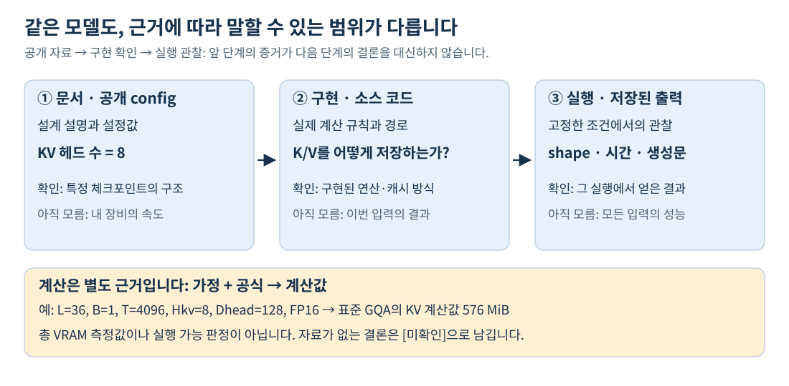
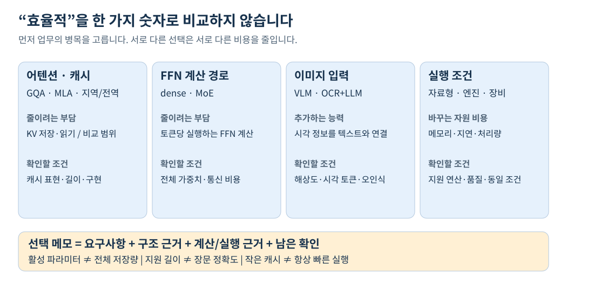

# 제13교시. 현대 LLM/VLM 아키텍처 종합 비교

### 이번 교시 핵심 용어

디코더 전용(decoder-only) · 희소 활성화(sparse activation) · 긴 문맥(long context) · 멀티모달 연결(multimodal connector)

「Transformer 이후 현대 LLM/VLM 아키텍처 변화의 이해와 실습」

## 1. 오늘의 질문

**모델 설명에 적힌 ‘효율적’이라는 말만으로 내 컴퓨터와 업무에 적합한 모델을 고를 수 있을까요?**

지금까지 관찰한 구조를 연결하여 모델 선택 근거를 작성합니다. 제8교시의 네 사례인 **GPT-2 기본형, Qwen3-4B, DeepSeek-V3, K-EXAONE-236B-A23B**를 유지합니다. 네 모델의 순위를 매기는 시간이 아닙니다. 같은 이름의 후속 버전이나 양자화 파생 모델을 섞지 않습니다. VLM의 입력 경로는 앞 교시에서 사용한 VLM 결과를 가져와 별도로 비교합니다.

**완료할 결과물:** 활동지에 ① 네 모델의 구조와 출처를 담은 근거표, ② 가정·단위·제외 항목을 명시한 KV 캐시 계산, ③ 상황 A–C의 후보 또는 보류 이유와 다음 확인 조건을 담은 선택 메모를 남깁니다.

준비물은 `lesson13-worksheet.md`, 제8교시 비교 결과, 앞 교시 Notebook의 저장된 출력입니다. VS Code 또는 문서 편집기로 작성합니다. **새 패키지, 모델 가중치, GPU 서버를 설치하거나 다운로드하지 않습니다.** Notebook 실행 없이 완료할 수 있습니다.

## 2. 근거를 네 종류로 표시합니다

**개념부터 확인:** 구조가 같아 보인다는 사실, 메모리를 계산한 값, 특정 환경에서 관찰한 출력은 서로 다른 근거입니다. 먼저 아래 네 표기를 구분한 뒤 그림의 각 상자가 무엇을 확인해 주는지 연결합니다.

- **[문서]** 공식 보고서·설정 파일·공개 구현에서 읽은 내용입니다. URL과 절·필드명·함수 이름 등 확인 위치를 적습니다. 설정은 구조 값을, 구현 소스는 실제 코드가 택하는 계산 경로를 보여 줍니다. 소스를 읽었다는 사실은 직접 실행했다는 뜻이 아닙니다.
- **[실행]** 내가 실행해서 관찰했고 직접 저장한 출력도 여기에 포함합니다. 교재에 제공된 저장 출력만 읽었다면 실행 근거의 출처를 **[참고 실행]**으로 적어 자신의 실행과 구별합니다. 두 경우 모두 확인 가능한 모델 버전, 입력, 자료형, 실행 환경과 출력 위치를 함께 적습니다.
- **[계산]** 명시한 가정으로 산출했습니다. 실제 메모리 측정값이나 속도가 아닙니다.
- **[미확인]** 자료나 실행이 없어 판단을 보류합니다. 빈칸을 그럴듯한 숫자로 채우지 않습니다.

### 왜 근거를 나누어야 하나요?

예를 들어 설정 파일에 `num_key_value_heads=8`이 있다고 합시다. 이것은 **K/V 헤드를 8개 사용하도록 설정했다**는 문서 근거입니다. 배치 크기·토큰 수·헤드 차원·자료형을 정해 캐시 바이트를 구하면 계산 근거가 됩니다. 실제로 모델을 실행하여 저장된 K/V 텐서의 shape나 메모리를 읽어야 실행 근거가 됩니다. 이 세 가지는 서로 연결되지만 같은 말은 아닙니다.

**왜 ‘계산상 작다’와 ‘실제로 빠르다’를 구분할까요?** 캐시가 작아도 실행 시간에는 가중치 읽기, 연산 구현, 장치, 입력 길이 등이 함께 영향을 줍니다. 계산은 무엇이 줄어들 수 있는지 설명하고, 동일한 조건의 실행 비교는 실제로 얼마나 달라졌는지 확인합니다. 실행하지 않았다면 ‘작은 캐시를 기대할 수 있는 구조’와 ‘이 장비에서 더 빨랐다’를 바꾸어 쓰지 않습니다.

**미확인은 빈 답이 아닙니다.** ‘Qwen3-4B의 한국어 품질은 미확인’이라고만 쓰기보다, ‘공개 한국어 문서와 확인 가능한 질문으로 검토해야 한다’고 다음 조건까지 적으면 선택을 위한 유용한 기록이 됩니다.

<!-- figure:lesson13-evidence-levels -->

**그림 설명:** ① 공개 설정과 ② 공개 구현은 모두 **[문서]**이지만 확인하는 대상이 다릅니다. ③ 저장 출력은 실행한 조건의 관찰입니다. 내가 직접 실행했으면 **[실행]**, 배포된 출력만 읽었으면 **[참고 실행]**을 붙입니다. 그림 하단의 KV 576 MiB는 명시된 가정에 따른 **[계산]**이며, 총 VRAM 측정값이나 실행 가능 판정이 아닙니다. 같은 조건의 속도 관찰이 없다면 더 빠르다는 결론은 **[미확인]**입니다.

## 3. 보고서와 config를 나란히 읽습니다

네 사례의 첫 공개 시기와 공식 발표 링크는 **8교시의 모델 소개**에서 확인할 수 있습니다. 아래 표의 기술 보고서 게시일이나 설정 파일 수정일과는 구분합니다.

보고서는 설계 이유를, config는 특정 체크포인트의 구조 값을 확인하는 데 사용합니다. config만으로 학습 데이터·업무 품질·초당 토큰 수를 확정하지 않습니다. 아래 공식 링크 또는 제8교시의 동일 모델 자료를 사용합니다. `sources/`에는 공식 설정의 고정 버전 사본과 출처 JSON이 있습니다. 인터넷이 없어도 이 파일로 필드를 확인할 수 있습니다. 제8교시 자료와 revision이 다르면 변경 여부를 기록하고 수치를 섞지 않습니다. 보고서 원문을 열지 못한 부분은 [미확인]으로 남깁니다.

| 사례 | 공식 보고서에서 볼 곳 | 체크포인트 설정에서 볼 곳 |
|---|---|---|
| GPT-2 기본형 | [GPT-2 보고서](https://cdn.openai.com/better-language-models/language_models_are_unsupervised_multitask_learners.pdf), §2.3 및 Table 2 | [config](https://huggingface.co/openai-community/gpt2/blob/607a30d783dfa663caf39e06633721c8d4cfcd7e/config.json): `n_layer`, `n_head`, `n_embd`, `n_positions` |
| Qwen3-4B | [Qwen3 보고서](https://arxiv.org/html/2505.09388v1), Architecture 및 dense 모델 표 | [config](https://huggingface.co/Qwen/Qwen3-4B/blob/1cfa9a7208912126459214e8b04321603b3df60c/config.json): `num_hidden_layers`, `num_attention_heads`, `num_key_value_heads`, **`head_dim`** |
| DeepSeek-V3 | [DeepSeek-V3 보고서](https://arxiv.org/html/2412.19437v2), §2.1 | [config](https://huggingface.co/deepseek-ai/DeepSeek-V3/blob/e815299b0bcbac849fa540c768ef21845365c9eb/config.json): `kv_lora_rank`, `qk_rope_head_dim`, `n_routed_experts`, `num_experts_per_tok` |
| K-EXAONE-236B-A23B | [K-EXAONE 보고서](https://arxiv.org/html/2601.01739v2), §2.1·Figure 2·Table 1 | [config](https://huggingface.co/LGAI-EXAONE/K-EXAONE-236B-A23B/blob/61e6d578eb102b578e5704e2916ac841df9eca0a/config.json): `layer_types`, `sliding_window`, `num_experts`, `num_experts_per_tok` |

GPT-2 보고서의 모델 규모 표기와 공개 구현의 실제 파라미터 계수는 표기 관례가 다를 수 있습니다. 이번 비교에서는 `openai-community/gpt2` 기본형을 사용하며, 수업에서 직접 센 값이 없다면 기술 보고서나 모델 카드의 수치를 [문서]로 기록하고, 직접 측정한 값으로 표시하지 않습니다. 보고서의 가장 큰 GPT-2 모델과 혼동하지 않습니다.

### 구조를 확인하는 질문

1. GPT-2와 Qwen3-4B는 dense FFN인가요? Q와 KV의 헤드 수는 같나요?
2. Qwen3 계열에 MoE가 있다는 사실이 Qwen3-4B도 MoE라는 뜻인가요?
3. DeepSeek-V3의 MLA와 K-EXAONE의 GQA·지역/전역 혼합 어텐션은 같은 캐시 공식을 그대로 사용할 수 있나요?
4. MoE의 전체 전문가 수와 토큰당 선택 전문가 수는 무엇이 다른가요? 공유 전문가는 별도인가요?
5. 네 모델의 config만 보고 이미지 파일을 입력할 수 있다고 결론 내릴 수 있나요?

## 4. 메모리 숫자는 무엇을 포함하는지 적습니다

### 4-1. 가중치 저장량의 단순 계산

`파라미터 수 × 파라미터당 바이트`를 계산합니다. FP16/BF16을 2바이트로 가정할 때 **반올림된 모델 규모를 이용한 가중치만의 근사치**는 Qwen3-4B 약 8 GB, DeepSeek-V3 약 1,342 GB, K-EXAONE 약 472 GB입니다. GB는 10⁹바이트, GiB는 2³⁰바이트입니다. [Qwen3-4B 공식 모델 카드](https://huggingface.co/Qwen/Qwen3-4B)의 규모 표기는 4.0B입니다. 정확한 계수와 저장 형식에 따라 값이 달라집니다.

이 값에는 KV 캐시, 중간 활성값, 작업 공간, 프레임워크와 양자화 메타데이터가 없습니다. [DeepSeek-V3의 고정 배포 설정](https://huggingface.co/deepseek-ai/DeepSeek-V3/blob/e815299b0bcbac849fa540c768ef21845365c9eb/config.json)에는 FP8 양자화 정보도 있으므로 이 BF16 계산을 실제 다운로드 크기로 부르지 않습니다. 4비트 계산도 이상적인 가중치 비트 수 계산일 뿐, 설치 후 총 VRAM 보장이 아닙니다.

**MoE에서 토큰당 활성 파라미터만 곱하여 전체 가중치 저장량을 구하면 안 됩니다.** 선택되지 않은 전문가도 다른 토큰에 필요할 수 있습니다. 분산 배치와 오프로딩은 저장 위치·전송 비용을 바꿉니다.

### 4-2. Qwen3-4B의 KV 캐시 계산 예

모든 레이어가 동일한 표준 GQA 캐시를 쓴다고 놓고 다음을 계산합니다.

`2(K,V) × L × B × T × Hkv × Dhead × bytes`

[고정 Qwen3-4B config](https://huggingface.co/Qwen/Qwen3-4B/blob/1cfa9a7208912126459214e8b04321603b3df60c/config.json)의 설정값 `L=36, Hkv=8, Dhead=128`, 가정 `B=1, T=4096, bytes=2`를 대입하면 **603,979,776바이트 = 576 MiB**입니다. 입력과 이미 처리한 출력 토큰을 합친 캐시 길이가 T입니다. `hidden_size / Q 헤드 수`로 head_dim을 임의 추정하지 않습니다. Qwen3-4B는 명시된 `head_dim=128`을 읽습니다.

T를 두 배로 하면 이 계산상 캐시는 두 배입니다. 이것이 전체 실행 시간이나 총 VRAM이 두 배라는 뜻은 아닙니다. MLA는 압축 잠재 표현의 저장 방식을, 혼합 어텐션은 레이어별 보존 길이와 실제 엔진 구현을 확인해야 합니다. **이 GQA 공식을 네 모델에 일괄 적용하지 않습니다.**

## 5. 세 가지 상황에서 선택하거나 보류합니다

**개념:** 모델 선택은 한 줄의 성능 순위가 아니라 요구사항과 병목을 연결하는 일입니다. 캐시 저장량, 토큰당 계산, 이미지 입력 능력, 실행 환경은 서로 다른 비교 축입니다. 먼저 아래 그림에서 각 축의 이점과 남는 조건을 읽고, 그 다음 상황 A–C를 판단합니다.

<!-- figure:lesson13-tradeoff-axes -->

**그림 설명:** 효율성을 단일 순위로 만들지 말고 업무의 병목과 연결하세요. 구조별 이점과 추가 확인 조건을 함께 남깁니다.

### 상황 A. 8GB GPU의 개인용 텍스트 초안 도우미
한국어 짧은 문서를 처리하고 외부 전송은 하지 않습니다. 네 사례 중 어떤 모델을 먼저 검토할까요? Qwen3-4B는 후보가 될 수 있지만, BF16 가중치 근사치만으로 이미 여유가 부족합니다. 실행을 확정하지 말고 지원되는 양자화 형식·짧은 입력·작은 배치에서의 후속 검증을 제안합니다. GPT-2는 구조 학습용 기준선과 한국어 업무용 후보를 구별하여 판단합니다.

### 상황 B. 긴 한국어 보고서를 처리하는 조직 서비스
허용 지연, 입력 길이, 동시 사용자 수와 사용할 수 있는 장비를 아직 정하지 않았습니다. 장문 구조에 맞는 후보와 추가로 물을 조건을 적습니다. 보고서의 최대 컨텍스트 수치를 곧바로 내 장비의 처리 가능 길이나 내용 이해 품질로 바꾸지 않습니다. 서버 구매·임대·API 가입은 하지 않습니다.

### 상황 C. 스캔 문서의 표를 읽는 도우미
네 텍스트 사례 중 억지로 하나를 고르지 않습니다. 제12교시의 **SmolVLM-256M-Instruct**를 별도 후보로 추가하고, **이미지 → 전처리/비전 인코더 → 연결부 → 언어 모델 → 텍스트** 경로를 그립니다. 모델에 따라 경로가 다르면 실제 구조에 맞게 수정합니다. 이미지 해상도, 시각 토큰 수, 작은 글자·표 구조 오류를 어떻게 확인할지도 적습니다. OCR+텍스트 LLM은 대안 파이프라인이지 텍스트 모델 자체가 VLM으로 바뀐 것은 아닙니다.

## 6. 근거 점검 기준

**작성 결과 점검:** 활동지 A의 구조 근거, B의 계산과 가정, C의 선택 메모를 나란히 놓습니다. 계산값은 단위와 포함 범위를, 실행값은 모델·입력·자료형·장비 조건과 직접 실행인지 참고 출력인지 먼저 확인하세요. 실행하지 않은 후보에 대해서는 자신의 측정 결과가 있는 것처럼 적지 말고, D에서 과장된 문장을 고칩니다.

점수를 매기지 않습니다. 각 항목을 ‘근거 있음 / 보완 필요 / 미확인’으로 표시합니다.

| 항목 | 확인할 질문 |
|---|---|
| 모델 식별 | 정확한 ID·체크포인트·설정 버전을 구별했나요? |
| 구조 적합성 | 요구 입력과 병목을 구조와 연결했나요? |
| 메모리 | 가중치·KV·실행 오버헤드를 분리했나요? |
| 연산·지연 | 활성 파라미터, 입력/출력 길이, 배치, 전송 비용을 고려했나요? |
| 증거 수준 | 보고서·실행·계산·미확인을 구별했나요? |
| 선택의 한계 | 제외 이유와 다음 검증 조건을 적었나요? |

친구가 ‘왜 이 모델인가요?’라고 물으면 **요구사항 하나, 구조 근거 하나, 계산 또는 실행 근거 하나, 미확인 사항 하나**로 답합니다. 활동지를 저장한 뒤 다음 교시에서 다시 사용합니다.
