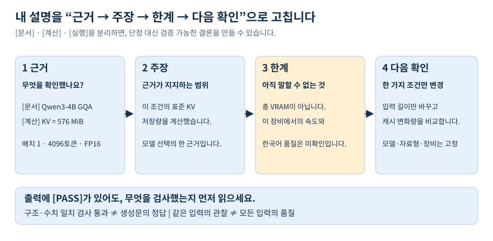

# 제14교시. 과정 정리와 자기 점검 Q&A

### 이번 교시 핵심 용어

실행 근거(execution evidence) · 재현성(reproducibility) · 정확도(accuracy) · 한계(limitation)

「Transformer 이후 현대 LLM/VLM 아키텍처 변화의 이해와 실습」

## 1. 오늘의 질문

**처음 보는 모델의 설명을 읽고, 무엇을 확인했고 무엇은 아직 모르는지 말할 수 있나요?**

새 모델이나 패키지를 설치하지 않습니다. 앞 교시의 저장된 결과와 제13교시 선택 메모를 사용합니다. 이 시간은 성적을 매기는 시험이 아니라 개념을 연결하고 모호한 설명을 고치는 시간입니다.

**완료할 결과물:** 활동지의 구조 변화 지도와 자기 점검 답을 작성하고, 제13교시 선택 메모에서 주장 하나를 근거·한계·다음 확인 조건이 드러나게 고칩니다.

준비: `lesson14-worksheet.md`, 제13교시 활동지, 앞 교시 Notebook의 출력. 실습 파일을 다시 실행할 필요는 없습니다. 모르는 부분을 확인하려고 대형 가중치를 받거나 원격 GPU를 만들지 않습니다.

## 2. 구조 변화 지도를 그립니다

**개념:** 새 구조는 서로 다른 병목을 줄이는 선택지입니다. 구조를 안다는 것만으로 품질이나 속도를 확정할 수는 없습니다. **근거 → 주장 → 한계 → 다음 확인** 순서로 설명하면 무엇을 확인했고 무엇은 모르는지 분리할 수 있습니다.

### 근거에서 어디까지 말할 수 있을까요?

**근거**는 내가 읽거나 계산하거나 관찰한 사실이고, **주장**은 그 사실을 바탕으로 내린 결론입니다. 예를 들어 ViT의 출력이 `(1, 1000)`이라는 사실은 ‘1000개 클래스의 점수를 만들었다’를 뒷받침합니다. 그러나 ‘그림을 정확히 알아봤다’까지 뒷받침하지는 않습니다. 제11교시의 도형 실습 이미지는 ImageNet 정답 레이블이 붙은 평가 자료가 아닙니다. 예측 클래스나 점수는 관찰할 수 있지만, 이 한 장으로 정확도를 구하거나 분류 품질을 판단하지 않습니다. 정확도를 말하려면 정답 레이블이 있는 별도의 평가 자료와 정확도 기준이 필요합니다.

**한계**는 설명을 약하게 만들기 위한 단서가 아니라 근거가 적용되는 경계입니다. 특정 입력에서 캐시가 늘어난 것을 확인했다면, 입력 길이·모델·자료형을 함께 적어야 다음 사람이 같은 조건으로 확인할 수 있습니다. 한 번의 관찰을 모든 입력과 모든 장비로 넓히지 않습니다.

**다음 확인**은 막연한 ‘더 실험하기’보다 바꿀 조건을 하나 정하는 것입니다. 예를 들어 모델과 자료형은 그대로 두고 입력 길이만 바꾸면 캐시 길이의 영향을 비교하기 쉽습니다. 모델·길이·장비를 동시에 바꾸면 무엇 때문에 결과가 달라졌는지 구별하기 어렵습니다. 이 시간에는 실행을 추가하지 않고 이런 비교 계획을 문장으로 남깁니다.

**활동: 구조 지도 만들기**

가운데에 ‘입력 → 토큰/특징 → 블록 반복 → 출력’을 씁니다. 아래 가지를 붙이고 각 가지 옆에 **해결하려는 문제 / 바뀌는 부분 / 여전히 남는 비용**을 한 줄씩 적습니다.

- 블록 구성: 정규화, 활성화, 위치 정보.
- 어텐션과 캐시: MHA·GQA·MLA, 지역/전역 어텐션.
- FFN의 계산 경로: dense와 MoE, 선택 전문가와 공유 전문가.
- 입력 확장: 이미지 특징과 언어 모델의 연결, 해상도와 시각 토큰.
- 추론 비용: 입력 처리와 토큰 생성, 캐시·가중치·작업 공간, 구현과 하드웨어.

모든 기법을 새 모델이 반드시 갖춘다고 쓰지 않습니다. 기술이 한 줄로 서로를 대체했다고 그리기보다, **서로 다른 병목을 줄이는 선택지**로 연결합니다. 앞 교시에서 직접 실행한 내용은 [실행], 배포된 저장 출력만 본 경우는 [참고 실행], 문헌·설정·구현에서 읽은 내용은 [문서]로 적습니다. 계산한 값과 확인하지 못한 부분에는 [계산], [미확인]을 붙입니다.

## 3. 자기 점검 Q&A

활동지에 먼저 자기 말로 답합니다. ‘설명 가능 / 근거를 보고 설명 / 다시 확인’ 중 하나를 표시합니다. 맞힌 개수를 점수로 계산하지 않습니다.

1. **GQA에서 Q 헤드는 많고 KV 헤드는 적어도 되는 이유는 무엇인가요?** 공유하는 대상과 KV 캐시에 저장하는 대상을 나눠 설명합니다.

   **답:** 여러 Q 헤드가 K·V 헤드 한 쌍을 공유합니다. 예를 들어 4교시 모델에서는 Q 헤드 9개를 3개씩 묶고, 그룹마다 K·V 헤드 한 쌍을 읽습니다. 캐시에는 그룹마다 계산한 K와 V만 저장합니다.
2. **Qwen3-4B의 hidden_size를 Q 헤드 수로 나누면 head_dim인가요?** [Qwen3-4B의 고정 config](https://huggingface.co/Qwen/Qwen3-4B/blob/1cfa9a7208912126459214e8b04321603b3df60c/config.json)에서 확인할 필드를 적습니다.

   **답:** 아닙니다. 이 모델은 설정의 `head_dim=128`을 읽어야 합니다. `hidden_size`는 블록의 표현 폭이고, Q를 투영한 뒤의 헤드당 폭과 항상 단순 나눗셈 관계에 있는 것은 아닙니다.
3. **MoE가 토큰당 23B를 활성화하면 가중치 23B만 저장하면 되나요?** 전체 가중치와 토큰당 계산 경로를 구별합니다.

   **답:** 아닙니다. 23B는 토큰 하나를 처리할 때 참여하는 파라미터 규모입니다. 다음 토큰은 다른 전문가를 선택할 수 있으므로 모델을 온전히 사용하려면 전체 가중치에 접근할 수 있어야 합니다. 모두 GPU에 상주시킬지는 배치 방식에 따라 달라집니다.
4. **MLA 캐시와 표준 GQA 캐시에 항상 같은 식을 쓰면 되나요?** 캐시가 표현하는 대상과 엔진 구현을 확인해야 하는 이유를 적습니다.

   **답:** 아닙니다. 표준 GQA는 헤드별 K와 V를 저장하지만, MLA 구현은 압축된 잠재 표현과 위치 관련 성분을 저장할 수 있습니다. 실제 엔진이 어떤 텐서를 어떤 자료형으로 보관하는지 확인한 뒤 크기를 계산합니다.
5. **컨텍스트 길이가 두 배이면 모든 비용이 두 배인가요?** 캐시 저장량, full attention의 입력 처리, 한 토큰 생성의 읽기 비용을 분리합니다. 실제 벽시계 시간은 별도 측정이라고 덧붙입니다.

   **답:** 아닙니다. 다른 조건이 같고 과거 위치를 모두 저장하면 KV 캐시 크기는 약 2배입니다. 전체 인과 어텐션의 입력 처리에서 위치 쌍 수는 긴 입력에서 약 4배, 새 토큰 하나가 참조하는 과거 위치 수는 약 2배입니다. 실제 실행 시간은 커널, 장치, 배치 등에 따라 달라 별도로 측정합니다.
6. **최대 컨텍스트가 큰 모델이면 긴 문서의 모든 질문에 잘 답하나요?** 지원 길이와 실제 정확도를 구분하고 검증할 질문을 만듭니다.

   **답:** 아닙니다. 지원 길이는 입력을 받을 수 있는 범위이지 정확도 보장이 아닙니다. 예를 들어 같은 정답 단서를 문서의 앞·중간·뒤에 놓고, 답과 근거 위치를 모두 맞히는지 비교할 수 있습니다.
7. **스캔 문서의 표를 텍스트 LLM에 파일 이름만 주면 읽을 수 있나요?** VLM 경로 또는 OCR 도구가 필요한 지점을 표시합니다.

   **답:** 아닙니다. 파일 이름은 표의 내용이 아닙니다. 이미지를 입력으로 전달할 수 있는 VLM을 쓰거나, OCR로 표를 추출해 행과 열의 관계를 보존한 텍스트로 전달합니다. 결과는 원본 표와 대조합니다.
8. **가중치 계산값이 8GB보다 작으면 8GB GPU 실행을 확정할 수 있나요?** 빠진 메모리 항목과 실행 조건을 적습니다.

   **답:** 확정할 수 없습니다. 가중치 외에 KV 캐시, 중간 텐서, 런타임 작업 공간이 필요합니다. 양자화 형식과 커널 지원, 실제 사용 가능 VRAM, 배치와 입력 길이를 확인하고 해당 조건에서 실행해 봐야 합니다.

답의 근거는 [제13교시 공식 자료와 계산](../lesson13/lesson13-guidebook.md), 앞 교시의 실제 출력에서 찾습니다. ‘그럴 것 같다’는 생각도 출발점은 되지만 문서 값이나 실행 사실로 표시하지 않습니다.

## 4. 내 설명의 과장을 고칩니다

**작성한 답 점검:** 제13교시의 선택 메모 한 문장을 골라, 그 문장이 기대는 근거와 그 근거로는 말할 수 없는 범위를 찾습니다. 아래 그림을 보고 활동지 D에서 문장을 고칩니다.

<!-- figure:lesson14-evidence-claim-limits -->

**그림 설명:** Qwen3-4B의 576 MiB는 정해진 조건에서 계산한 KV 캐시 저장량입니다. 그림은 FP16, 제13교시 예는 BF16을 가정하지만 둘 다 원소당 2바이트라 이 저장량 계산은 같습니다. 두 형식의 수치 정밀도나 실행 성능이 같다는 뜻은 아닙니다. 이 근거로 총 VRAM이나 업무 품질을 단정하지 않습니다. 구조 검사 PASS도 답변 정확성을 뜻하지 않습니다. 다음 확인에서는 유지할 조건과 바꿀 조건 하나를 정합니다.

제13교시 결론에서 다음 표현을 찾아 수정합니다.

| 수정이 필요한 표현 | 바꿔 쓸 방향 |
|---|---|
| ‘최신이라 가장 좋습니다.’ | 어떤 요구사항에 어떤 구조가 도움이 되는지 씁니다. |
| ‘4비트면 무조건 실행됩니다.’ | 가중치 근사, 지원 형식, 캐시와 오버헤드, 검증 조건을 적습니다. |
| ‘논문에서 빠르므로 내 PC에서도 빠릅니다.’ | 보고서의 조건과 내 조건을 구분합니다. |
| ‘실험 결과 576 MiB입니다.’ | 실제 측정하지 않았다면 ‘명시한 조건의 KV 계산값’이라고 씁니다. |
| ‘이미지를 읽습니다.’ | 이미지 입력 경로와 원본을 대조한 근거를 적습니다. |

**수정 예:** ‘Qwen3-4B를 후보로 남깁니다. [공식 설정](https://huggingface.co/Qwen/Qwen3-4B/blob/1cfa9a7208912126459214e8b04321603b3df60c/config.json)은 GQA이고, 배치1·4096토큰·BF16의 표준 KV 계산은 576 MiB입니다. 이것은 총 VRAM이 아니며, 해당 GPU에서의 실행 가능 여부와 한국어 문서 품질은 아직 확인하지 않았습니다.’

## 5. 질문을 재현 가능한 형태로 남깁니다

‘안 됩니다’ 대신 다음 양식을 씁니다.

> 제가 확인하려는 것은 __입니다. 모델 ID와 버전은 __, 입력 조건은 __입니다. 문서/계산/실행으로 __까지 확인했습니다. 아직 __가 불분명합니다. 다음에는 __를 한 가지만 바꿔 비교하려고 합니다.

오류가 있었다면 파일·셀 번호와 오류 전문을 남깁니다. 외부 공유 전 API 키, 토큰, 개인정보는 제거합니다. 모르는 것은 남겨두되 다음에 확인할 자료나 실험을 구체적으로 씁니다.

## 6. 마무리

- [ ] 같은 모델 계열 안에서도 구조가 다름을 설명합니다.
- [ ] 구조와 품질·속도·메모리의 관계를 단정하지 않습니다.
- [ ] 공식 자료, 실제 실행, 계산, 미확인을 구분합니다.
- [ ] 다음 모델을 검토할 때 확인할 항목을 스스로 적을 수 있습니다.

활동지와 수정한 선택 메모를 저장합니다. 다음 학습은 필요한 한 가지로 좁힙니다. 예를 들어 ‘지원되는 소형 모델로 입력 길이만 바꾸어 캐시 증가량 비교’ 또는 ‘같은 문서 이미지에서 해상도만 바꾸어 작은 글자 인식 차이 확인’처럼 비교 조건을 고정합니다. 이 시간에 추가 실행이나 환경 변경까지 할 필요는 없습니다.
